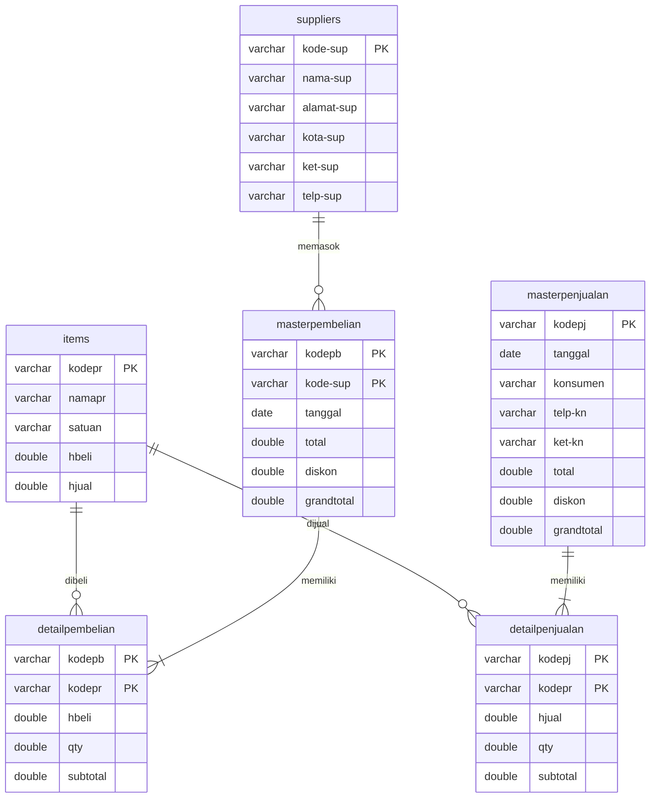

# LunaStore: Sales & Transaction System

Aplikasi web berbasis PHP native dan MySQL untuk mengelola data master produk, supplier, transaksi pembelian, dan transaksi penjualan pada sebuah toko. Aplikasi ini menampilkan grafik ringkasan transaksi, menghitung diskon dan kembalian secara otomatis, serta mencetak laporan ke PDF dan CSV.


---

## Daftar Isi

- [Fitur Utama](#fitur-utama)
- [Teknologi](#teknologi)
- [Struktur Folder](#struktur-folder)
- [Struktur Database](#struktur-database)
- [Instalasi](#instalasi)
- [Cara Penggunaan](#cara-penggunaan)
- [Alur Kerja Aplikasi](#alur-kerja-aplikasi)
- [Catatan Pengembangan](#catatan-pengembangan)
- [Lisensi](#lisensi)

---

## Fitur Utama

### 1. Dashboard
- Grafik batang total **penjualan** dan **pembelian** per tanggal.
- Filter rentang tanggal (tanggal awal dan tanggal akhir).
- Format nilai dalam Rupiah (`Rp`) dengan pemisah ribuan Indonesia.

### 2. Master Produk
- Menampilkan daftar produk dalam tabel interaktif (DataTables).
- Tambah, ubah, dan hapus produk melalui modal Bootstrap.
- Data produk: kode, nama, satuan, harga beli, dan harga jual.

### 3. Master Supplier
- Menampilkan daftar supplier.
- Tambah, ubah, dan hapus supplier.
- Data supplier: kode, nama, alamat, kota, keterangan, dan nomor telepon.

### 4. Transaksi Penjualan
- Form transaksi dengan keranjang item yang dipilih dari daftar master produk.
- Perhitungan otomatis **subtotal**, **diskon (%)**, **grand total**, **bayar**, dan **kembalian**.
- Kode transaksi unik dibuat otomatis dengan format `pj + YYYYMMDDHHMMSS + 2 digit acak`.
- Riwayat penjualan dengan filter tanggal dan modal detail transaksi.
- Cetak rekap dan detail transaksi ke **PDF**.
- Ekspor rekap ke **CSV** (bisa dibuka di Microsoft Excel).

### 5. Transaksi Pembelian
- Form pembelian barang dari supplier terdaftar.
- Perhitungan otomatis subtotal, diskon, dan grand total.
- Kode transaksi unik dengan format `pb + YYYYMMDDHHMMSS + 2 digit acak`.
- Riwayat pembelian dengan filter tanggal, detail transaksi, cetak PDF, dan ekspor CSV.

---

## Teknologi

| Lapisan | Teknologi |
|---|---|
| Backend | PHP (native) dengan ekstensi `mysqli` |
| Database | MySQL 8.0 |
| Frontend | HTML5, CSS3, Bootstrap 5.0.2 |
| Interaksi | jQuery 3.7.1 dan AJAX |
| Tabel data | DataTables |
| Grafik | Chart.js 4.5.0 |
| Laporan PDF | FPDF 1.9 |
| Server lokal | XAMPP / Laragon (Apache + MySQL) |

---

## Struktur Folder

```
Sales&Transaction/
├── index.php                 # Halaman utama (navbar + area konten dinamis)
├── connect.php               # Koneksi ke database MySQL
├── dashboard.php             # Grafik penjualan & pembelian
│
├── produk.php                # Halaman master produk
├── insertprdk.php            # Endpoint tambah produk
├── updateprdk.php            # Endpoint ubah produk
├── deleteprdk.php            # Endpoint hapus produk
│
├── supplier.php              # Halaman master supplier
├── insertsup.php             # Endpoint tambah supplier
├── updatesup.php             # Endpoint ubah supplier
├── deletesup.php             # Endpoint hapus supplier
│
├── penjualan.php             # Form input transaksi penjualan
├── savepenjualan.php         # Riwayat penjualan + handler simpan (AJAX)
├── get_detail_penjualan.php  # Endpoint JSON detail penjualan
├── printpenjualan.php        # Cetak rekap penjualan (PDF)
├── printdetailjual.php       # Cetak detail penjualan (PDF)
├── excelpenjualan.php        # Ekspor rekap penjualan (CSV)
│
├── pembelian.php             # Form input transaksi pembelian
├── savepembelian.php         # Riwayat pembelian + handler simpan (AJAX)
├── get_detail_pembelian.php  # Endpoint JSON detail pembelian
├── printpembelian.php        # Cetak rekap pembelian (PDF)
├── printdetailbeli.php       # Cetak detail pembelian (PDF)
├── excelpembelian.php        # Ekspor rekap pembelian (CSV)
│
├── toko.sql                  # Dump struktur dan data contoh database
├── css/style.css             # Styling tambahan
├── js/chart.js               # Library Chart.js
├── DataTables/               # Library DataTables
└── fpdf19/                   # Library FPDF 1.9
```

---

## Struktur Database

Nama database: **`toko`**. Database terdiri dari 6 tabel dengan pola **master-detail** untuk setiap transaksi.

| Tabel | Fungsi | Primary Key |
|---|---|---|
| `items` | Master produk | `kodepr` |
| `suppliers` | Master supplier | `kode-sup` |
| `masterpenjualan` | Header transaksi penjualan | `kodepj` |
| `detailpenjualan` | Item dalam transaksi penjualan | `kodepj`, `kodepr` |
| `masterpembelian` | Header transaksi pembelian | `kodepb`, `kode-sup` |
| `detailpembelian` | Item dalam transaksi pembelian | `kodepb`, `kodepr` |

### Entity Relationship Diagram



---

## Instalasi

### Prasyarat
- PHP 7.4 atau lebih baru (disarankan PHP 8.x) dengan ekstensi `mysqli` aktif
- MySQL 8.0 atau MariaDB
- Web server Apache (XAMPP, Laragon, atau sejenisnya)
- Koneksi internet untuk memuat Bootstrap dan jQuery dari CDN

### Langkah Instalasi

1. **Clone repository**
   ```bash
   git clone https://github.com/<username>/<nama-repo>.git
   ```

2. **Pindahkan folder project** ke direktori web server.
   - XAMPP: `C:\xampp\htdocs\`
   - Laragon: `C:\laragon\www\`

   > Disarankan mengganti nama folder `Sales&Transaction` menjadi `sales-transaction`. Karakter `&` pada URL dapat menimbulkan masalah di browser.

3. **Import database**
   - Buka phpMyAdmin di `http://localhost/phpmyadmin`.
   - Pilih tab **Import**, lalu unggah file `toko.sql`.
   - Script akan membuat database `toko` beserta tabel dan data contohnya.

   Atau melalui terminal:
   ```bash
   mysql -u root -p < toko.sql
   ```

4. **Sesuaikan koneksi database** di `connect.php` bila kredensial Anda berbeda:
   ```php
   $conn = new mysqli("localhost", "root", "", "toko");
   ```

5. **Jalankan aplikasi** melalui browser:
   ```
   http://localhost/sales-transaction/
   ```

---

## Cara Penggunaan

1. **Dashboard** tampil pertama kali. Pilih rentang tanggal, lalu klik **Filter** untuk melihat grafik.
2. Buka menu **produk** untuk mengisi data barang sebelum membuat transaksi.
3. Buka menu **supplier** untuk mendaftarkan pemasok barang.
4. Buka menu **pembelian** atau **penjualan**:
   - Klik tombol tambah untuk membuka form transaksi.
   - Pilih item dari daftar master produk, lalu isi jumlah (qty).
   - Isi persentase diskon. Pada penjualan, isi juga nominal bayar untuk menghitung kembalian.
   - Klik **Save** untuk menyimpan transaksi.
5. Pada halaman riwayat transaksi:
   - Klik tombol **view** untuk melihat detail transaksi.
   - Klik **Print** untuk mencetak laporan PDF.
   - Klik **Excel** untuk mengunduh rekap dalam format CSV.

---

## Lisensi

Project ini dibuat untuk keperluan pembelajaran. Library pihak ketiga mengikuti lisensinya masing-masing:
- [FPDF](http://www.fpdf.org/) (lisensi permisif, lihat `fpdf19/license.txt`)
- [Chart.js](https://www.chartjs.org/) (MIT License)
- [DataTables](https://datatables.net/) (MIT License)
- [Bootstrap](https://getbootstrap.com/) (MIT License)
- [jQuery](https://jquery.com/) (MIT License)
